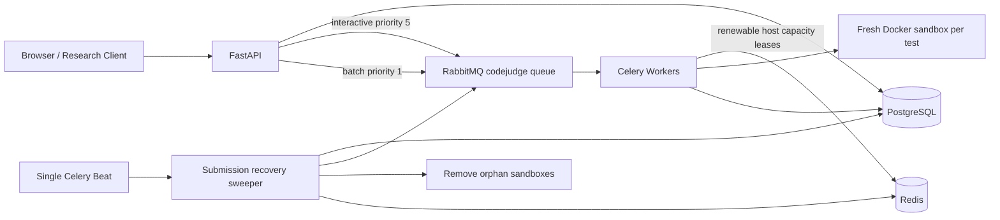

# Architecture

## Submission flow

1. The API authenticates the user, checks ownership and limits, and stores each submission before publishing its Celery task.
2. Single submissions use priority 5; batch submissions use priority 1. The durable `codejudge` queue is declared with maximum priority 10.
3. A worker atomically marks a pending submission as running, acquires a Redis worker lease, creates its work directory, and loads the problem test cases.
4. Each test runs in a fresh container with networking disabled and resource limits applied. Expected output stays outside the container.
5. Results and resource measurements are persisted in PostgreSQL; the worker finalizes the submission and releases its leases.

## Batch data and API

`batches` stores owner, name, model name, total, status, and timestamps. Submissions reference a batch through nullable `batch_id`; existing single-submission behavior and historical rows remain unchanged. `repeat_index` distinguishes expanded repeats, and `queued_at` records the queue-wait start time.

Batch requests are fully validated before rows are committed. A batch and all of its submissions are inserted transactionally; publishing uses one producer connection. If publication fails, rows remain pending for the recovery sweeper rather than disappearing. Authenticated endpoints provide owner-scoped batch listing, progress, filtered/paged items, CSV export, pending-work cancellation, failed-item reruns, and batch-scoped statistics. Source code is included only when explicitly requested; hidden tests and expected outputs are not returned.

## Capacity and recovery

- `WORKER_CONCURRENCY` bounds task processes/threads per worker.
- `MAX_PARALLEL_CONTAINERS` independently caps sandboxes for a physical host. A process-local semaphore combines with renewable Redis leases, scoped by `WORKER_HOST_ID`, so worker replicas on one host share the same limit.
- Worker leases/heartbeats and `task_acks_late` / `task_reject_on_worker_lost` support recovery after abrupt worker loss.
- The single Celery Beat service invokes the sweeper every 60 seconds. It republishes pending work older than `BATCH_STALE_PENDING_SECONDS` (120 seconds by default), marks a running submission without a live worker lease as an error after ten minutes, removes orphan sandboxes, and finalizes batches without active work.
- The worker sweeper uses a Redis lock so accidental overlapping invocations do not perform duplicate recovery.

The batch request limit, per-user rate limit, active-submission limit, request body size, worker concurrency, host container capacity, and database connection pool are environment-configurable. See [DEPLOYMENT.md](DEPLOYMENT.md) for variable meanings and capacity guidance.

## Research outputs

The browser exposes live progress and filtered submission metrics. The benchmark client accepts JSONL/JSON/CSV inputs, chunks requests to the configured batch limit, waits for completion, and combines CSV exports. The metrics tool calculates pass@k, pass rate, timing/memory percentiles, throughput, and queue wait from those exports. Concurrent runs can affect wall-clock timing; report repeats and the worker/container configuration.
