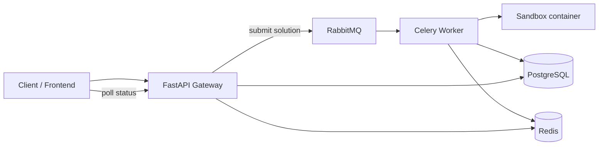

# Architecture

The worker pipeline is:
1. Save submission and mark RUNNING.
2. Load problem and all test cases.
3. Create a host-backed work directory and source files.
4. Compile if needed.
5. Run each test case in a fresh sandbox container.
6. Compare outputs, persist run_results, and finalize verdict.
